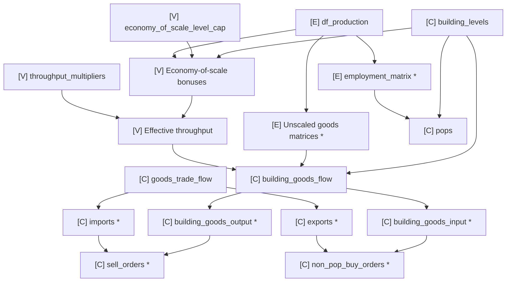
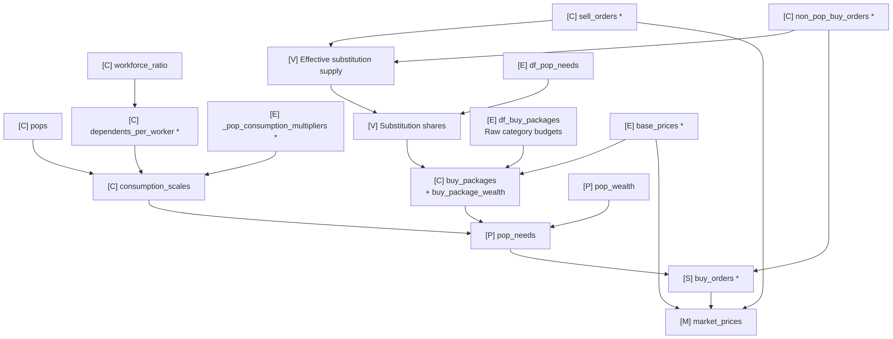
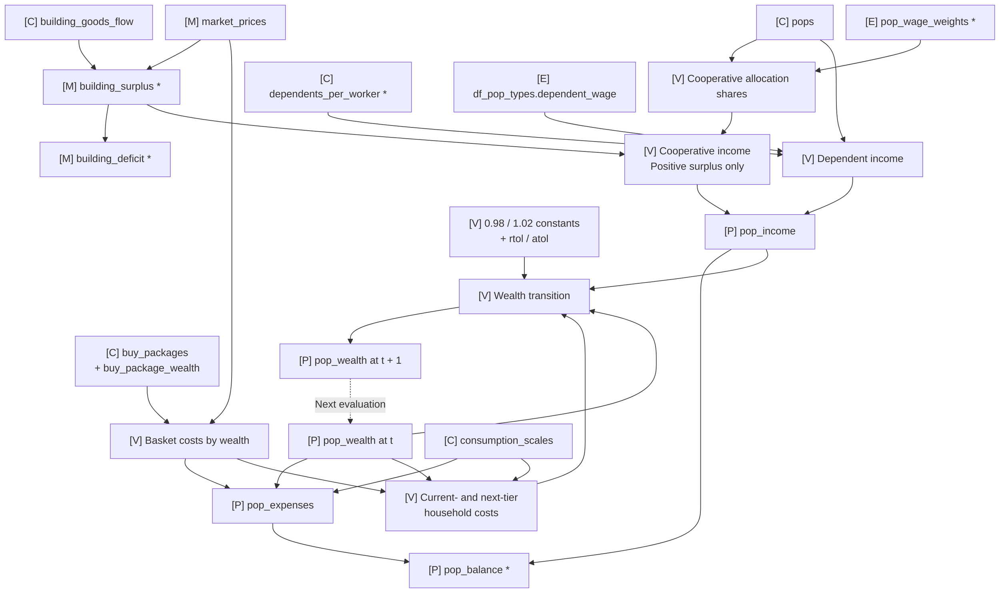
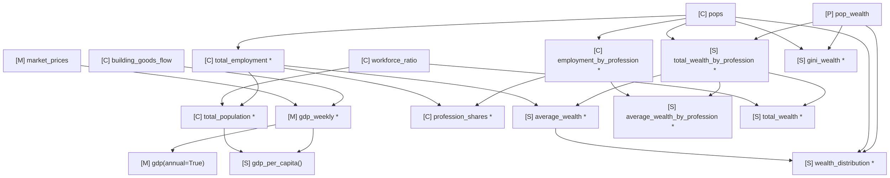

# Economy dependencies

These graphs describe the current economy model. An arrow means the source
is needed to calculate the target; it does not imply that every solve mode
runs that calculation. Dashed arrows carry wealth into the next iteration.
Repeated node names refer to the same value across graphs.
Wide diagrams scroll horizontally to preserve readable labels.

For usage, see the [economy guide](../guides/economy.md). The
[API reference](../api/economy.md) describes the public interfaces, and the
[economy data dictionary](../data-dictionary/economy.md) defines report units
and accounting boundaries.

## Storage legend

<ul class="dependency-legend">
  <li>E <code>Economy</code>: game tables and model coefficients.</li>
  <li>C <code>EconomyContext</code>: fixed inputs shared by snapshots.</li>
  <li>M <code>MarketState</code>: prices and building finances.</li>
  <li>P <code>PopState</code>: household wealth, demand, and finances.</li>
  <li>S <code>EconomyState</code>: the composed snapshot and combined reports.</li>
  <li>V A separate argument, returned value, constant, or solver working variable.</li>
</ul>

An asterisk (`*`) marks a cached property. Methods ending in `()` calculate
their return values on demand without caching them. Textual owner prefixes
remain meaningful without color.

`EconomyState` holds `context`, `market`, and `households` references. Its flat
properties, such as `state.building_goods_flow` and `state.pop_income`, forward
to the component owners shown here; they do not duplicate the arrays.

## Production preparation

Building levels, production coefficients, and effective throughput determine
realized weekly goods flows. Employment scales with building levels, while
throughput changes goods inputs and outputs without scaling worker counts.
Effective throughput adds the economy-of-scale bonus to the supplied multiplier.

Flows retain the production table's signed-net convention within each
configuration. Splitting signs before aggregation preserves opposing orders
between different configurations. No separate gross-flow parsing is implied.

## Consumption and market prices

`Economy.df_buy_packages` contains raw need-category budgets at base prices.
Prepared `EconomyContext.buy_packages` contains goods quantities by wealth
tier; `buy_package_wealth` labels its rows. These are different representations.

Prepared baskets and scales are optional context fields. `prepare_context()`
computes only missing fields; supplied fields are authoritative. Baskets stay
fixed while production, trade, and substitution assumptions are fixed. Scales
stay fixed while worker counts, workforce ratio, and profession multipliers
are fixed. Changing wealth selects different basket rows; changing prices
changes their monetary cost rather than their quantities.

`calculate_buy_packages()` returns an independent DataFrame for inspection.
`calculate_pop_consumption_scales()`, `calculate_pop_needs()`, and
`calculate_pop_expenses()` return arrays without updating a snapshot.
Preparation and wealth evaluation attach the appropriate results to their
owners. The evaluator calculates total buy orders as a working array; the
composed snapshot exposes the same quantity through cached `buy_orders`.

## Household finances and iteration

Cooperative income distributes each configuration's positive value added
according to worker counts and profession wage weights. Dependent earnings
are added separately. Expenses value the selected baskets at the same market
prices. Basket costs, income coefficients, and transitions are solver working
values, rather than additional public state fields.

`evaluate_wealth(context, pop_wealth)` evaluates one assignment without changing
wealth and returns matching `MarketState` and `PopState` components. `iterate()`
trusts consistent evaluated inputs, applies simultaneous one-tier changes using
the previous prices and income, and evaluates the new assignment. It shares the
fixed context and returns the original components when wealth is unchanged.

The transition decreases wealth below 98% of current-tier cost; otherwise it
increases wealth at or above 102% of next-tier cost, within configured numerical
tolerances. Decreases take precedence, and minimum/maximum tiers bound movement.
`solve(method="equilibrium")` repeats evaluation and transition, detects cycles
and iteration limits, and independently verifies a stationary result. Numerical
convergence does not guarantee affordability at the minimum tier or funded
building losses; `equilibrium_diagnostics` records these flags on `EconomyState`.

`pop_income` and `pop_expenses` are optional `PopState` fields. Nominal and market
solves leave them unevaluated, and `pop_balance` is `None` until both are supplied.
When evaluated, balance is the signed weekly difference between income and
expenses; it is not an accumulated savings stock.

## Derived reports

Fixed population metrics belong to the context, price-valued production metrics
belong to the market, and reports combining wealth with fixed population data
belong to the composed economy snapshot.

Wealth statistics describe integer consumption tiers rather than monetary
assets. GDP is production value added; it does not include the exogenous
dependent earnings added to household income. Employment-weighted profession
totals are cached once and shared by the wealth summaries and population report.
The uniform workforce ratio makes per-capita wealth equal to average wealth.

