# Buy packages

Buy packages describe political strength and the amount assigned to each
population-need category at every wealth level. The combined parsing example
writes all eight parsed tables and both linear- and log-scale SVG charts for
every non-wealth buy-package column.

[:fontawesome-brands-github: View `examples/parse.py`](https://github.com/ShabbyGayBar/victoria3-analysis/blob/DEV/examples/parse.py)

```bash
uv run python -m examples.parse
```

## Table preview

Important columns include `wealth`, `political_strength`, `total_popneeds`, and
the individual `popneed_*` categories.

<!-- table-preview: artifacts/datasets/parsed/buy_packages/buy_packages.csv | columns=wealth,political_strength,total_popneeds,popneed_basic_food,popneed_services,popneed_luxury_items | rows=5 -->

[:material-download: Download `artifacts/datasets/parsed/buy_packages/buy_packages.csv`](../artifacts/datasets/parsed/buy_packages/buy_packages.csv)

## Figure gallery

Select a figure to open or download the full SVG.

<div class="figure-gallery">
<figure class="figure-card"><a href="../../artifacts/datasets/parsed/buy_packages/figures/political_strength.svg">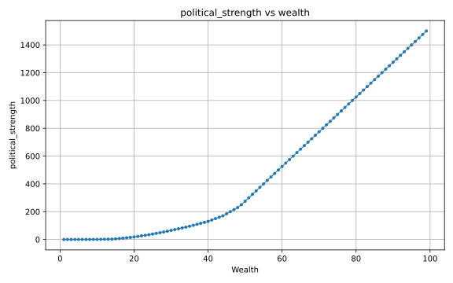</a><figcaption><code>artifacts/datasets/parsed/buy_packages/figures/political_strength.svg</code><br>Political strength</figcaption></figure>
<figure class="figure-card"><a href="../../artifacts/datasets/parsed/buy_packages/figures/total_popneeds.svg">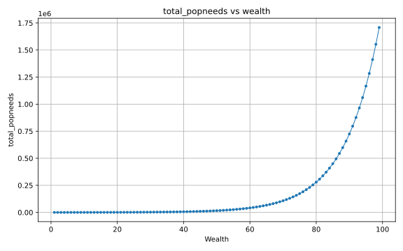</a><figcaption><code>artifacts/datasets/parsed/buy_packages/figures/total_popneeds.svg</code><br>Total population needs</figcaption></figure>
<figure class="figure-card"><a href="../../artifacts/datasets/parsed/buy_packages/figures/popneed_basic_food.svg">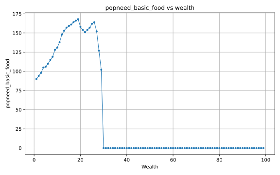</a><figcaption><code>artifacts/datasets/parsed/buy_packages/figures/popneed_basic_food.svg</code><br>Basic food</figcaption></figure>
<figure class="figure-card"><a href="../../artifacts/datasets/parsed/buy_packages/figures/popneed_communication.svg">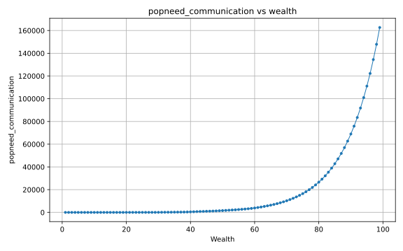</a><figcaption><code>artifacts/datasets/parsed/buy_packages/figures/popneed_communication.svg</code><br>Communication</figcaption></figure>
<figure class="figure-card"><a href="../../artifacts/datasets/parsed/buy_packages/figures/popneed_crude_items.svg">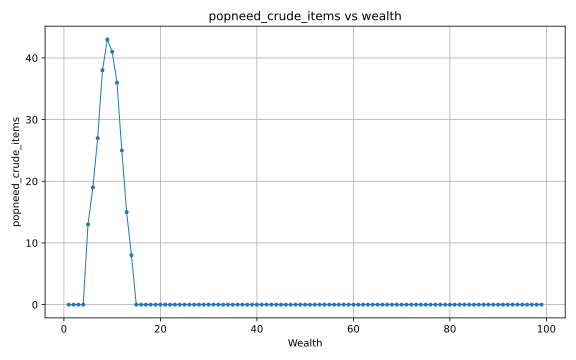</a><figcaption><code>artifacts/datasets/parsed/buy_packages/figures/popneed_crude_items.svg</code><br>Crude items</figcaption></figure>
<figure class="figure-card"><a href="../../artifacts/datasets/parsed/buy_packages/figures/popneed_free_movement.svg"></a><figcaption><code>artifacts/datasets/parsed/buy_packages/figures/popneed_free_movement.svg</code><br>Free movement</figcaption></figure>
<figure class="figure-card"><a href="../../artifacts/datasets/parsed/buy_packages/figures/popneed_heating.svg">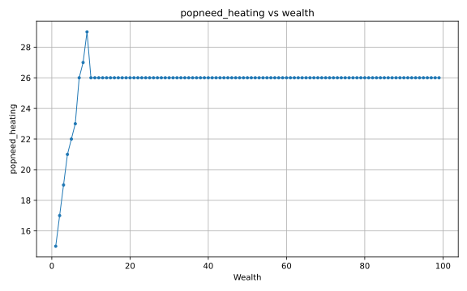</a><figcaption><code>artifacts/datasets/parsed/buy_packages/figures/popneed_heating.svg</code><br>Heating</figcaption></figure>
<figure class="figure-card"><a href="../../artifacts/datasets/parsed/buy_packages/figures/popneed_household_items.svg">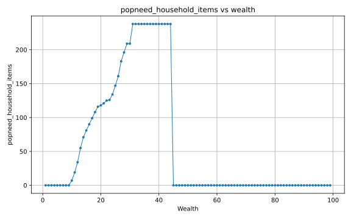</a><figcaption><code>artifacts/datasets/parsed/buy_packages/figures/popneed_household_items.svg</code><br>Household items</figcaption></figure>
<figure class="figure-card"><a href="../../artifacts/datasets/parsed/buy_packages/figures/popneed_intoxicants.svg">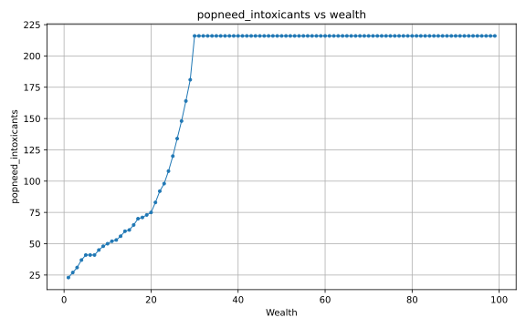</a><figcaption><code>artifacts/datasets/parsed/buy_packages/figures/popneed_intoxicants.svg</code><br>Intoxicants</figcaption></figure>
<figure class="figure-card"><a href="../../artifacts/datasets/parsed/buy_packages/figures/popneed_leisure.svg">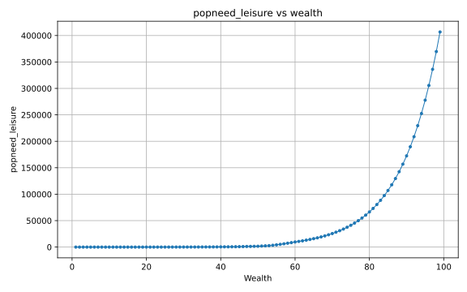</a><figcaption><code>artifacts/datasets/parsed/buy_packages/figures/popneed_leisure.svg</code><br>Leisure</figcaption></figure>
<figure class="figure-card"><a href="../../artifacts/datasets/parsed/buy_packages/figures/popneed_luxury_drinks.svg">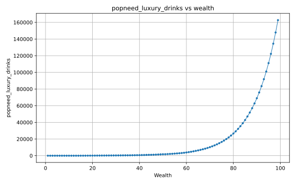</a><figcaption><code>artifacts/datasets/parsed/buy_packages/figures/popneed_luxury_drinks.svg</code><br>Luxury drinks</figcaption></figure>
<figure class="figure-card"><a href="../../artifacts/datasets/parsed/buy_packages/figures/popneed_luxury_food.svg">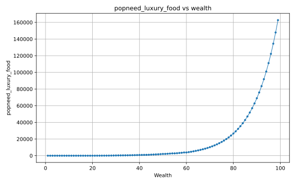</a><figcaption><code>artifacts/datasets/parsed/buy_packages/figures/popneed_luxury_food.svg</code><br>Luxury food</figcaption></figure>
<figure class="figure-card"><a href="../../artifacts/datasets/parsed/buy_packages/figures/popneed_luxury_items.svg"></a><figcaption><code>artifacts/datasets/parsed/buy_packages/figures/popneed_luxury_items.svg</code><br>Luxury items</figcaption></figure>
<figure class="figure-card"><a href="../../artifacts/datasets/parsed/buy_packages/figures/popneed_services.svg">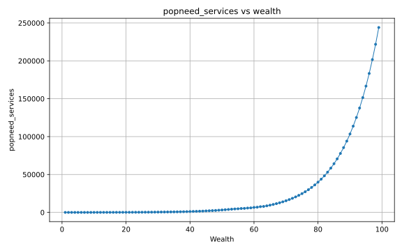</a><figcaption><code>artifacts/datasets/parsed/buy_packages/figures/popneed_services.svg</code><br>Services</figcaption></figure>
<figure class="figure-card"><a href="../../artifacts/datasets/parsed/buy_packages/figures/popneed_simple_clothing.svg">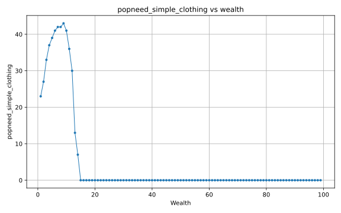</a><figcaption><code>artifacts/datasets/parsed/buy_packages/figures/popneed_simple_clothing.svg</code><br>Simple clothing</figcaption></figure>
<figure class="figure-card"><a href="../../artifacts/datasets/parsed/buy_packages/figures/popneed_standard_clothing.svg">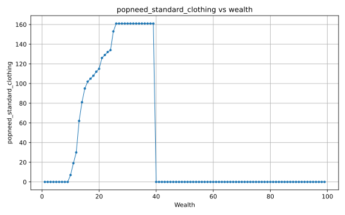</a><figcaption><code>artifacts/datasets/parsed/buy_packages/figures/popneed_standard_clothing.svg</code><br>Standard clothing</figcaption></figure>
<figure class="figure-card"><a href="../../artifacts/datasets/parsed/buy_packages/figures/popneed_stimulants.svg">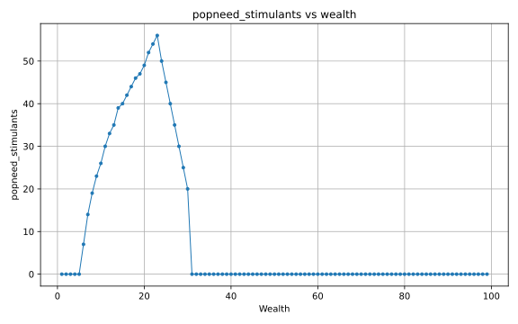</a><figcaption><code>artifacts/datasets/parsed/buy_packages/figures/popneed_stimulants.svg</code><br>Stimulants</figcaption></figure>
</div>

## Log-scale figures

Log-scale versions make changes across the full range of wealth levels easier
to compare:

- [`artifacts/datasets/parsed/buy_packages/figures/political_strength_log.svg`](../artifacts/datasets/parsed/buy_packages/figures/political_strength_log.svg)
- [`artifacts/datasets/parsed/buy_packages/figures/total_popneeds_log.svg`](../artifacts/datasets/parsed/buy_packages/figures/total_popneeds_log.svg)
- [`artifacts/datasets/parsed/buy_packages/figures/popneed_basic_food_log.svg`](../artifacts/datasets/parsed/buy_packages/figures/popneed_basic_food_log.svg)
- [`artifacts/datasets/parsed/buy_packages/figures/popneed_communication_log.svg`](../artifacts/datasets/parsed/buy_packages/figures/popneed_communication_log.svg)
- [`artifacts/datasets/parsed/buy_packages/figures/popneed_crude_items_log.svg`](../artifacts/datasets/parsed/buy_packages/figures/popneed_crude_items_log.svg)
- [`artifacts/datasets/parsed/buy_packages/figures/popneed_free_movement_log.svg`](../artifacts/datasets/parsed/buy_packages/figures/popneed_free_movement_log.svg)
- [`artifacts/datasets/parsed/buy_packages/figures/popneed_heating_log.svg`](../artifacts/datasets/parsed/buy_packages/figures/popneed_heating_log.svg)
- [`artifacts/datasets/parsed/buy_packages/figures/popneed_household_items_log.svg`](../artifacts/datasets/parsed/buy_packages/figures/popneed_household_items_log.svg)
- [`artifacts/datasets/parsed/buy_packages/figures/popneed_intoxicants_log.svg`](../artifacts/datasets/parsed/buy_packages/figures/popneed_intoxicants_log.svg)
- [`artifacts/datasets/parsed/buy_packages/figures/popneed_leisure_log.svg`](../artifacts/datasets/parsed/buy_packages/figures/popneed_leisure_log.svg)
- [`artifacts/datasets/parsed/buy_packages/figures/popneed_luxury_drinks_log.svg`](../artifacts/datasets/parsed/buy_packages/figures/popneed_luxury_drinks_log.svg)
- [`artifacts/datasets/parsed/buy_packages/figures/popneed_luxury_food_log.svg`](../artifacts/datasets/parsed/buy_packages/figures/popneed_luxury_food_log.svg)
- [`artifacts/datasets/parsed/buy_packages/figures/popneed_luxury_items_log.svg`](../artifacts/datasets/parsed/buy_packages/figures/popneed_luxury_items_log.svg)
- [`artifacts/datasets/parsed/buy_packages/figures/popneed_services_log.svg`](../artifacts/datasets/parsed/buy_packages/figures/popneed_services_log.svg)
- [`artifacts/datasets/parsed/buy_packages/figures/popneed_simple_clothing_log.svg`](../artifacts/datasets/parsed/buy_packages/figures/popneed_simple_clothing_log.svg)
- [`artifacts/datasets/parsed/buy_packages/figures/popneed_standard_clothing_log.svg`](../artifacts/datasets/parsed/buy_packages/figures/popneed_standard_clothing_log.svg)
- [`artifacts/datasets/parsed/buy_packages/figures/popneed_stimulants_log.svg`](../artifacts/datasets/parsed/buy_packages/figures/popneed_stimulants_log.svg)
