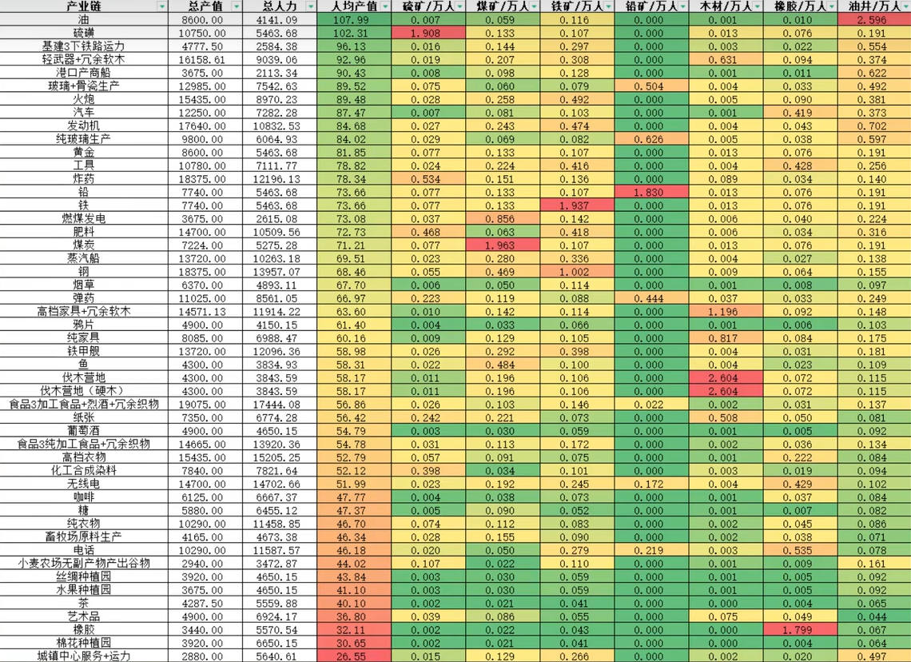

# Supply chains

In the [previous chapter](./production-unit-rankings.md), we ranked production units (buildings with certain production methods combinations) by their employment and construction requirements. But in the end, a country's economy cannot be solely based on oil rigs and automobile factories (unless you actually go for it). A world-dominating superpower's economy must be self-sufficient, which means some people must work in less productive production units to produce the upstream goods.

So this time, our analysis focuses on goods. We will find a set of production units, so that overall, the set produces at least a certain amount of a specific good (and maybe some inevitable byproducts) but consumes only labor and construction points, and no other goods at all. We call this set of production units a **supply chain**.

The supply chain can be visualized as a directed graph, where the nodes are goods and production units, and the edges are the flows of goods between them.

There are multiple implementations of a supply chain, one of which would be optimized for different objectives, such as minimizing employment or construction points. We are here today to find them, with the help of `examples/supply_chain_compare.py`, which solves for the minimum employment and minimum construction supply chains for every producible good, under different configurations.

The [supply-chain guide](../guides/supply-chain.md) explains the API and graph
model. The [data dictionary](../data-dictionary/supply-chain.md) defines the
report columns, units, formulas, and failure behavior.

[:fontawesome-brands-github: View `examples/supply_chain_compare.py`](https://github.com/ShabbyGayBar/victoria3-analysis/blob/DEV/examples/supply_chain_compare.py)

## Methodology

To normalize the comparison, each supply chain has a weekly target base value of **£100,000** of its corresponding terminal good, with target quantity calculated as `100_000 / base_price`. Note that this is a minimum net-production target. Surplus and coproducts are possible, so equal target value does not imply equal GDP or make goods interchangeable.

The following table summarizes the three scenarios used in the comparison, with their objectives and additional restrictions. The `cangshulun` preset, originating from [this video](https://www.bilibili.com/video/BV1xKiGBeEGg), bans certain oil-using production methods to represent the resource constraints. Monuments, ownership buildings and government buildings are also banned in all configurations, as they are not part of the production chain.

| Configuration | Objective | Technology and additional restrictions |
| --- | --- | --- |
| `era_3_construction` | Minimum whole-system construction | Era 3 |
| `era_5_automation` | Minimum whole-system employment | Era 5 |
| `cangshulun` | Minimum whole-system employment | Era 5, `CANGSHULUN_BANNED_PMS`, and `CANGSHULUN_BUILDING_LIMITS` |

Note that the above constraints do not simulate every in-game law, qualification, or state-specific PM restriction. These are idealized model requirements, with no wage costs or profession availability constraints.

A failed solve produces a configuration-summary row with its requested target,
status, and error text, and the script continues to the next configuration and good.
Failed configurations have no detailed reports or plots. Unknown goods,
duplicate good keys, and invalid base prices raise before any output is written.

## The automobile supply chain

The employment and construction requirements for the automobile supply chain under different scenarios are summarized in the following table.

| Configuration | Status | Employment (workers) | Construction (points) |
| --- | --- | ---: | ---: |
| Era 3 construction | Infeasible | Unavailable | Unavailable |
| Era 5 automation | Success | 125,161 | 25,217.7 |
| Cangshulun | Success | 138,218 | 27,713.7 |

The £100,000 target corresponds to **1,000 automobiles per week**. Both
successful cases produce £100,000 of weekly value added, or £5.2 million
annually, while using different amounts of labor and construction. In this
example, whole-system and terminal-chain totals agree; that equality is not
a general guarantee of the API.

Within `analyses/supply_chains/era_5_automation/automobiles/`, the reports explain
where those requirements come from:

- `goods.csv` and `goods_balance.svg` compare supply, consumption, imports,
  and net production. The terminal production floor is a separate constraint,
  rather than a population or export buy order.
- `processes.csv` identifies the selected building/PM configurations and
  their levels. `flows.csv` records process inputs and outputs.
- `workforce.csv` and `workforce.svg` describe employment by profession.
  Minimizing total employment does not necessarily minimize skilled labor.
- `constraints.csv`, `bottlenecks.csv`, and `constraints.svg` expose LP
  diagnostics and useful binding inequalities. Marginals are local and
  objective-specific, and constraints can have different units.
- `alternatives.csv` lists all allowed producer configurations, including
  inactive ones. The diagrams can prune alternatives for readability.

[](../artifacts/analyses/supply_chains/era_5_automation/automobiles/goods_balance.svg)

*Era 5 automation: automobile-chain goods balance, in units per week.*

[](../artifacts/analyses/supply_chains/era_5_automation/automobiles/constraints.svg)

*Era 5 automation: binding automobile-chain constraints, measured in workers saved per relaxed constraint unit.*

### The supply chain network graphs

`supply_chain_recipe.mmd` shows the allowed technology and
`supply_chain_realised.mmd` the realized chain. `network.svg` weights realized
edges by base-price value. Its layout distances have no economic units.

Allowed automobile technology in the era 5 automation preset:

```mermaid
--8<-- "artifacts/analyses/supply_chains/era_5_automation/automobiles/supply_chain_recipe.mmd"
```

Realized automobile chain:

```mermaid
--8<-- "artifacts/analyses/supply_chains/era_5_automation/automobiles/supply_chain_realised.mmd"
```

[](../artifacts/analyses/supply_chains/era_5_automation/automobiles/network.svg)

*Era 5 automation: realized automobile network, with edge widths weighted by weekly base-price value (£).*

Cycles represent real feedback. For example, oil extraction can consume engines
while motor industries consume oil. A traversal cutoff does not turn either
good into a free resource. Check the quantitative flows rather than inferring
requirements from graph depth.

The regenerated era 5 automobile network contains **16 processes, 16 goods,
and 77 edges**, with one cyclic component. The allowed graph includes many
more alternatives, so a pruned diagram cannot establish their total count.

### Compare contributions

`contributions_gdp.svg`, `contributions_employment.svg`, and
`contributions_construction_cost.svg` show leading whole-process contributions
to the terminal chain. The same process can matter very differently for labor,
construction, and value added.

[](../artifacts/analyses/supply_chains/era_5_automation/automobiles/contributions_gdp.svg)

*Era 5 automation: leading automobile-chain contributions to weekly value added (£).*

[](../artifacts/analyses/supply_chains/era_5_automation/automobiles/contributions_employment.svg)

*Era 5 automation: leading automobile-chain employment contributions, in workers.*

[](../artifacts/analyses/supply_chains/era_5_automation/automobiles/contributions_construction_cost.svg)

*Era 5 automation: leading automobile-chain construction contributions, in construction points.*

For the era 5 automobile chain, automotive assembly employs **70,000 workers**
and requires **16,000 construction points**. The upstream chain therefore
accounts for another 55,161 workers. Rubber plantations employ about 16,392
workers but require only 655.7 construction points; oil rigs employ 15,590
workers and require 2,078.7 points. Their relative importance changes between
the employment and construction charts. Machinists and engineers together
account for **73.9% of chain employment**, which illustrates why a small total
workforce can still depend heavily on skilled professions.

[](../artifacts/analyses/supply_chains/era_5_automation/automobiles/workforce.svg)

*Era 5 automation: automobile-chain workforce by profession, in workers.*

Chain totals include whole selected processes, including their coproducts;
they do not allocate a factory's workers or construction uniquely to one good.
Whole-system totals can also include activity outside the graph-defined chain.
Weekly value added is output base value minus intermediate input base cost;
annual GDP is 52 times weekly GDP.

## Goods & scenario sweep

The combined summary is
`artifacts/analyses/supply_chains/comparison/summary.csv`.
It contains one row per good/configuration pair selected in the current run,
in requested good order and then configuration order. It retains failures.
Each configuration has one `summary.csv` combining its selected goods,
for example `analyses/supply_chains/era_5_automation/summary.csv`.
It records each good's target, objective, solver status, whole-system totals,
chain totals, and configuration labels. No summary files are written inside
the individual good directories.
Use a single configuration when ranking goods under common assumptions.

<!-- table-preview: artifacts/analyses/supply_chains/comparison/summary.csv | columns=good,configuration,status,chain_gdp_per_capita_annual,chain_wage_normalized_employment,chain_levels_building_coal_mine,chain_levels_per_10k_pop_building_coal_mine | rows=5 -->

[:material-download: Download all-good comparison](../artifacts/analyses/supply_chains/comparison/summary.csv)

The comparison directory contains this summary and three grouped bar charts:

- `pop.svg` plots `system_employment`, the whole-system employed population
  in workers. It excludes dependents and unemployed people.
- `construction_points.svg` plots `system_construction_cost` in construction
  points.
- `gdp_per_capita.svg` plots `system_gdp_per_capita_annual`: annual system GDP
  divided by system employment, in £ per worker per year. Zero employment gives
  zero, matching the economy model's GDP-per-capita convention.

All charts use goods as the main horizontal-axis ticks, with configuration
ticks beneath the individual bars. Colors identify configurations consistently
between charts. A failed solve keeps its tick and shows an × instead of a bar;
it is not treated as a zero requirement. SVG width grows with the number of
goods so the two tick levels remain readable when zoomed.

[](../artifacts/analyses/supply_chains/comparison/pop.svg)

*All three configurations: whole-system employment by terminal good, in workers.*

[](../artifacts/analyses/supply_chains/comparison/construction_points.svg)

*All three configurations: whole-system construction requirements by terminal good, in construction points.*

[](../artifacts/analyses/supply_chains/comparison/gdp_per_capita.svg)

*All three configurations: annual whole-system GDP per employed worker, in £ per worker per year.*

Click any chart to open the original SVG and zoom in on its labels.

[:material-download: Population chart](../artifacts/analyses/supply_chains/comparison/pop.svg)
· [:material-download: Construction chart](../artifacts/analyses/supply_chains/comparison/construction_points.svg)
· [:material-download: Annual GDP per capita chart](../artifacts/analyses/supply_chains/comparison/gdp_per_capita.svg)

```python
from pathlib import Path
import pandas as pd

comparison = pd.read_csv(
    Path("artifacts/analyses/supply_chains/comparison/summary.csv")
)
successful = comparison.loc[
    comparison["configuration"].eq("era_5_automation")
    & comparison["status"].eq("success")
]
lowest_employment = successful.sort_values(
    ["system_employment", "good"], kind="stable"
).head(10)
```

Sorting the automation rows by construction answers which of those
minimum-employment chains uses least construction. It does not compute a
minimum-construction optimum for each good.

## Reproducing Cangshulun's video

Apart from the video mentioned above, the uploader also made a [follow-up video](https://www.bilibili.com/video/BV1yJcEzLEih) running a complete supply chain analysis for all goods on the 1.12 patch. His methodology is not mathematic programming, but rather a leontief matrix approach, where production units are selected manually. To reproduce his results, the `examples/supply_chain_cangshulun.py` script adds throughput bonuses, production-method bans, and named product variants to approximate the video's assumptions.

```bash
uv run python -m examples.supply_chain_cangshulun
```

The script writes the latest complete results to
`artifacts/analyses/supply_chains/cangshulun_video/summary.csv`. The frozen
`artifacts/analyses/supply_chains/cangshulun_video/summary_1.12.csv` contains
60 scenarios from the **1.12.5** results, extracted from artifact commit
`e7a3748964cf28f453db1899f08636eb04c45d71` and sorted by annual value added per
worker. It retains only the columns used for the video comparison:

- `scenario`
- `system_gdp_annual`
- `system_employment`
- `system_gdp_per_capita_annual`
- `system_levels_per_10k_pop_building_sulfur_mine`
- `system_levels_per_10k_pop_building_coal_mine`
- `system_levels_per_10k_pop_building_iron_mine`
- `system_levels_per_10k_pop_building_lead_mine`
- `system_levels_per_10k_pop_building_logging_camp`
- `system_levels_per_10k_pop_building_rubber_plantation`
- `system_levels_per_10k_pop_building_oil_rig`

The video's table at **1:04** is reproduced below. Its total value column is
weekly, so compare it with `system_gdp_annual / 52`; its per-worker value is
annual and corresponds to `system_gdp_per_capita_annual`. Resource columns
measure building levels per 10,000 employed workers. Our runs target £100,000
of weekly terminal output, so raw value and employment totals have a different
scale from the screenshot; compare the per-worker and per-10,000-worker ratios.

[](./cangshulun-video-1.12-table.png)

*Source: Cangshulun's [video](https://www.bilibili.com/video/BV1yJcEzLEih), 1:04.
Click the image to inspect the full table.*

<!-- table-preview: artifacts/analyses/supply_chains/cangshulun_video/summary_1.12.csv | columns=scenario,system_gdp_per_capita_annual,system_levels_per_10k_pop_building_coal_mine,system_levels_per_10k_pop_building_oil_rig | rows=5 -->

The following examples compare annual nominal value added per employed worker
(£/worker/year). Difference means `(project / video - 1) * 100%`.

| Supply chain | Video 1.12.4 | Project 1.12.5 | Difference |
| --- | ---: | ---: | ---: |
| Oil | 107.99 | 108.92 | +0.9% |
| Sulfur | 102.31 | 103.36 | +1.0% |
| Automobiles | 87.47 | 88.86 | +1.6% |
| Engines | 84.68 | 86.90 | +2.6% |
| Tools | 78.82 | 80.93 | +2.7% |
| Coal-fired electricity | 73.08 | 73.14 | +0.1% |
| Rubber | 32.11 | 32.21 | +0.3% |
| Luxury furniture + surplus wood | 63.60 | 57.86 | −9.0% |
| Fine art | 36.80 | 18.10 | −50.8% |
| Urban services + transportation | 26.55 | 14.01 | −47.2% |

The electricity, luxury-furniture, and urban-service rows use the
`coal_fired_plant:electricity`, `luxury_furniture:luxury_furniture`, and
`urban_center_transportation:services` scenarios respectively; the other rows
use `base:<good>` scenarios. The close results support the video's broad
productivity ranking, but several rows with larger differences prevent an exact reproduction.
Production-method and coproduct choices can differ because the optimizer
selects a minimum-employment chain rather than the video's fixed recipe.

Looking back on the results, the drastic drops in fine-art and urban-service productivity are due to throughput bonuses in the video that are not present in the script's preset. In particular, the video excludes the company bonus for urban centers and arts academies, which does not imply zero throughput bonuses overall.

[:material-download: Download 1.12 selected results (1.12.5 inputs)](../artifacts/analyses/supply_chains/cangshulun_video/summary_1.12.csv)
· [:material-download: Download latest complete results (1.13.11)](../artifacts/analyses/supply_chains/cangshulun_video/summary.csv)
· [:fontawesome-brands-github: View `examples/supply_chain_cangshulun.py`](https://github.com/ShabbyGayBar/victoria3-analysis/blob/DEV/examples/supply_chain_cangshulun.py)

## Output inventory

Paths are relative to `--output-dir`. All text outputs use UTF-8 without a BOM.
The comparison writes one detailed result at a time rather than retaining
all goods' graphs and snapshots in memory.

| Directory | Files |
| --- | --- |
| `analyses/supply_chains/era_3_construction/<good>/` | Detailed files below for successful solves |
| `analyses/supply_chains/era_5_automation/<good>/` | Same reports, plots, and diagrams |
| `analyses/supply_chains/cangshulun/<good>/` | Same reports, plots, and diagrams |
| `analyses/supply_chains/<configuration>/` | `summary.csv`, combining that configuration's selected goods |
| `analyses/supply_chains/comparison/` | `summary.csv`, `pop.svg`, `construction_points.svg`, `gdp_per_capita.svg`, covering all selected goods and presets |
| `analyses/supply_chains/cangshulun_video/` | Latest complete `summary.csv` and frozen selected-column `summary_1.12.csv`; ordinary generation updates only `summary.csv` |

Each successful comparison configuration contains `goods.csv`, `processes.csv`,
`flows.csv`, `workforce.csv`, `constraints.csv`, `bottlenecks.csv`,
`alternatives.csv`, `supply_chain_recipe.mmd`, `supply_chain_realised.mmd`,
`network.svg`, `goods_balance.svg`, `workforce.svg`, `constraints.svg`,
`contributions_gdp.svg`, `contributions_employment.svg`, and
`contributions_construction_cost.svg`. Headline metrics and failure rows are
stored only in the configuration-level `summary.csv` and comparison CSVs.

The configuration summary and comparison CSVs use the public sweep schema,
plus `configuration` and `ban_config`. GDP efficiency and per-building resource
levels, including levels per 10,000 employed workers, are public summary fields
shared with the video export. The other detailed CSVs retain their
public report schemas. Cross-good summaries sit at configuration level.
A selected-good run replaces the configuration summaries and combined
comparison with that run's selection; other goods' directories remain.
